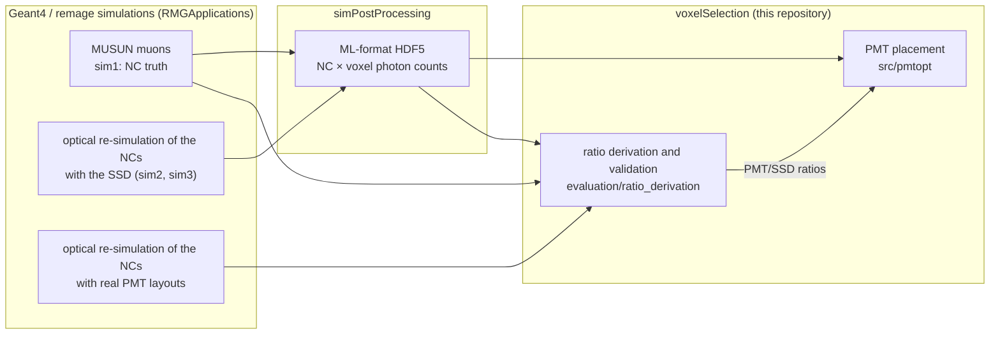

# voxelSelection

Optimisation of the PMT placement of the LEGEND-1000 neutron tagger, the photomultiplier system of
the water tank, on simulated neutron-capture (NC) light. The repository selects PMT positions on a
voxelized sensitive surface detector (SSD), converts the SSD photon counts to PMT-equivalent counts,
and validates this conversion against full simulations with real PMTs.

This repository is part of my master's thesis *"Optimisation of the LEGEND-1000 Neutron Tagger Using a
Surrogate Monte Carlo Simulation"* (Eberhard Karls Universität Tübingen). Its input data are produced
by [simPostProcessing](https://github.com/UniThommi/simPostProcessing).

## Background

<sup>77</sup>Ge, produced when cosmic-muon-induced neutrons are captured on <sup>76</sup>Ge, is a
background for the neutrinoless double-beta decay search of LEGEND-1000. Muons that produce
<sup>77</sup>Ge ("Ge77 muons") can be tagged by detecting the light of the neutron captures that
follow the muon. A tagged muon starts a dead time in the germanium detectors, so the PMT layout has to
tag as many Ge77 muons as possible while vetoing few other muons.

In the simulation, the inner surfaces of the water tank (`pit`, `bot`, `wall`, `top`) are an SSD
divided into 9583 voxels of 195 mm × 195 mm, each standing for one possible PMT position
([simPostProcessing](https://github.com/UniThommi/simPostProcessing#background) shows the geometry).
A PMT of radius 131 mm fits on 8569 of them (pit 1109, bot 56, top 1288, wall 6116); only these are
candidates for the selection. A layout of N PMTs (N = 300 in the thesis) is a subset of these voxels.

Detection is defined by three thresholds:

- **m**: minimum number of detected photons (photoelectrons) on one PMT (voxel) for it to fire,
- **M**: minimum number of fired PMTs for an NC to be detected (photons within 200 ns after the NC),
- **W**: minimum number of detected NCs inside the muon window [1 µs, 200 µs] after the muon for the
  muon to be classified as a Ge77 muon. Every detected NC in the window counts, whether or not it is
  the capture that produced <sup>77</sup>Ge.

A muon is a Ge77 muon (ground truth) if any of its NCs carries the <sup>77</sup>Ge flag.

## Where this repository fits



simPostProcessing turns the raw SSD simulations into one HDF5 file with a row per NC
(`target_matrix`: photons per voxel, `phi_matrix`: NC features, `event_ids`: `(run_id, muon_id,
nc_id)`, `primaries`: number of simulated muons). The layout is described in the
[simPostProcessing README](https://github.com/UniThommi/simPostProcessing#output-format) and listed in
its `data_structure/` directory. The PMT simulations are read directly from the raw remage output by
`evaluation/ratio_derivation/ratio_analysis/raw_loading.py`.

## Repository structure

```
voxelSelection/
├── src/
│   ├── pmtopt/             core package: ratio scaling, greedy selection, reference layouts, metrics
│   └── latex_export/       voxel_table.py: LaTeX tables of voxel selections
├── evaluation/
│   ├── ratio_derivation/   derivation and validation of the PMT/SSD ratios (SSD vs PMT simulations)
│   │   └── ratio_analysis/ shared helpers: raw loading, zones, photon filters, coverage analysis
│   └── optimizeDetectionTime.py
├── musun_nc_analysis/      analyses of the MUSUN NC simulation
├── tests/                  unit tests (rotation, W2 metric)
└── pyproject.toml          package `pmtopt`
```

## Core functionality (`src/pmtopt/`)

All subcommands are run through `python -m pmtopt.main <subcommand>`.

### From SSD photons to PMT detections

An SSD voxel combines the optical properties of a PMT with those of the reflective foil, so it does not
detect the same number of photons as a PMT at that position. `data_loading.binarize_from_raw`
therefore multiplies the photon count of every voxel by the PMT/SSD ratio of its area and rounds the
result stochastically (floor plus a Bernoulli draw with the fractional part, so the expectation is
exact while counts stay integer, with a fixed seed) to the according efficiency. The result is thresholded at m, giving the sparse
binary matrix `B` (NC × voxel) on which all optimizations work. Voxels where a PMT would not fit are
removed first (`geometry.is_valid_pmt_position`).

Ratios can be passed with `--pit/--bot/--top/--wall`. `greedy --write-hdf5` writes a copy of the
input file with the ratio-scaled counts (`ratio_scaling.write_ratio_hdf5`).

### Greedy PMT selection (`greedy`)

Choosing N of 8569 positions is a coverage problem whose exact solution is NP-hard, so the voxels are
selected greedily: in every step the voxel with the largest marginal gain is added (`greedy.py`).

- `--optimize nc`: maximize the number of NCs seen by at least M selected voxels. For M > 1 the
  default *priority* mode takes the voxel that promotes most NCs from M−1 to M hits whenever there is
  one, otherwise the best voxel at M = 1; `--dynamic` lowers the target level step by step instead.
- `--optimize muon-ge77`: maximize the number of Ge77 muons with at least W detected NCs in the muon
  window. For W > 1, a voxel that brings muons to W detected NCs is preferred; `--dynamic` sweeps W
  from high to low. In this mode the CLI fixes M = 1.
- `--worst`: inverse benchmark that picks the voxel with the smallest gain.
- Selected PMTs on the same surface keep a minimum distance of 2 × 131 mm (`--no-spacing` disables
  this and also the validity filter); `--per-area` distributes N over the areas in proportion to their
  surface and optimizes each area separately; `--areas` restricts the placement; `--muon-weight K`
  weights additional NCs of the same muon with diminishing returns, f(d) = 1 − exp(−d/K).
- `--sensitivity` repeats the selection with additional ratios scaled by (1 + δ) and compares the layouts
  (Jaccard index of the selected voxels, change of efficiency; `sensitivity.py`).

Each run writes `<name>.json` (selected voxels with center, corners and layer, plus the run
configuration), `<name>.npz` (selected columns, efficiency per step, configuration) and `<name>.png`
(3D view), where `<name>` encodes all parameters, plus plots of the photon distribution and of the
voxel geometry.

### Reference layouts and homogeneity

- `homogeneous`: `--mode generate` builds the voxel grid from the geometry constants;
  `--mode select` places N PMTs homogeneously (area-proportional allocation, Fibonacci spirals snapped
  to the nearest valid voxel). This is the homogeneous reference layout.
- **W2 homogeneity** (`homogeneous.compute_wasserstein_homogeneity`): exact 2-Wasserstein distance
  between the PMT positions and 3000 Fibonacci points that cover the detector surface uniformly; lower
  values mean a more uniform layout.
- `rotate`: rotates a layout azimuthally and maps every PMT to the nearest valid voxel; the explore
  mode scans all collision-free angles, which is used to check the rotation invariance of W2.
- `sample-w2-range`: generate sets of layouts that span the range of W2 homogeneity.
- `plot`, `plot-hits`, `plot-homogeneity`, `plot-w2`: plots of existing layouts and of the photon
  distribution.

### Evaluation and figure of merit (`python -m pmtopt.evaluate_coverages`)

Evaluates several layouts on the same SSD dataset: NC detection fraction for each M, Ge77-muon
confusion matrix (TP, FP, FN, TN over all simulated muons) for each (M, W), recall and precision, and
the figure of merit. The FoM (`geometry.figure_of_merit`) is the median discovery significance of
Cowan et al., *Eur. Phys. J. C* 71 (2011) 1554, computed from

- the Ge77 survival: Ge77 NCs of untagged Ge77 muons divided by all Ge77 NCs, i.e. each Ge77 muon is
  weighted with the number of <sup>77</sup>Ge nuclei it produced (`calc_fom_confusion`; the unweighted
  original definition is kept as `calc_figure_of_merit`), and
- the signal survival 1 − dead time, with a dead time of five mean lifetimes of <sup>77m</sup>Ge per
  tagged muon and the simulated live time from the MUSUN muon rate.

The physics parameters of the FoM are preliminary.

## Evaluation: ratio derivation (`evaluation/ratio_derivation/`)

The PMT/SSD ratios are what makes the SSD a surrogate for real PMTs, so they are derived and validated
against optical simulations of the same NCs with real PMT layouts (that SSD and PMT simulations contain
exactly the same NCs can be checked with simPostProcessing's
`validate_neutron_capture_consistency.py`). The analyses form one workflow:

1. **Zone ratios, detector-matching** (`zone_ratio_analysis.py`). Each area is divided into zones
   (radial rings on pit and top, height bands on the wall, one zone on bot) whose boundaries give equal
   PMT density; PMTs on a boundary are shared by their cathode area in each zone. Per zone,
   ratio = (PMT photons per NC) / (SSD photons per NC), corrected for the PMT density of the zone.
   This ratio scales the SSD hits so that all voxels together register as many detections as the
   PMTs. A zone-count scan compares the spread of the zone ratios with their statistical uncertainty
   (SNR = σ<sub>zone</sub> / ⟨σ<sub>R</sub>⟩); if it is significant, the area would have to be split into
   sub-areas with separate ratios. The analysis is run on the MUSUN data and on homogeneously
   distributed NCs (`--mode musun | homogeneous`).
2. **Per-PMT ratios, PMT-matching** (`zone_ratio_analysis.py --per-pmt-ratio` or `--per-pmt-only`).
   For every PMT of the PMT simulation and the SSD voxel at the same position,
   ratio<sub>i</sub> = (PMT hits<sub>i</sub> per NC) / (voxel hits<sub>i</sub> per NC), read from the
   post-processed SSD file. With the multi-simulation file this ratio sets each voxel to the efficiency
   of a PMT; its per-area values are the default ratios above.
3. **Validation** (`correlate_ssd_pmt.py`). For several layouts, the same voxel positions are evaluated
   with ratio-scaled SSD data (same code path as the optimizer) and with the full PMT simulation of that
   layout. NC detection per M, Ge77 recall per (M, W) and the FoM are compared (Pearson and Spearman
   correlation, relative deviation (SSD − PMT) / PMT, ranking of the layouts). Both sides use the same
   muon classification.
4. **Quick check of the raw counts** (`compare_pmt_ssd.py`). Total photons per PMT and per SSD voxel at
   the same position, without scaling: relative deviation (PMT − SSD) / mean, spatial maps and
   NC-matched correlations.

Further scripts in this directory:

- `compare_coverages.py`: evaluation of several PMT simulations (the PMT-side counterpart of
  `evaluate_coverages`), including an NC-truth statistical limit as upper bound on the achievable
  Ge77 survival and live time.
- `check_ssd_postprocessed.py`: checks that post-processing does not lose photons (raw SSD vs
  post-processed counts, globally and per NC).
- `ssd_hit_histogram.py`: histogram of the total hits per voxel in a post-processed file.
- `wall_gradient_diagnostic.py`: distributions of NC positions and of detected photons (position, time,
  incidence angle) for SSD and PMT, used to understand the height dependence of the wall ratio.

## Other scripts

- `evaluation/optimizeDetectionTime.py`: compares photon arrival-time metrics and NC detection
  efficiency of simulations with different pit and wall distance configurations (settings are
  constants at the top of the file).
- `musun_nc_analysis/analyseMusunNCs.py`: distributions of the MUSUN muons and their NCs (Ge77 vs
  non-Ge77 muons, NC positions and times, outliers) from the raw sim1 output.
- `musun_nc_analysis/lightAnalysisHomogeneousPMTs.py`: light detected per NC and per muon in the
  simulation with homogeneously placed PMTs, matched to the MUSUN NC truth.
- `src/latex_export/voxel_table.py`: writes a LaTeX `longtable` of the voxel positions of a layout.
- `tests/`: unit tests for `rotate` and the W2 metric; `test_FoM_formular.py` prints one FoM value.

## Installation

Python ≥ 3.11. From the repository root:

```bash
pip install -e .
```

This installs `pmtopt` with numpy, scipy, matplotlib, h5py and POT. The scripts in `evaluation/` and
`musun_nc_analysis/` additionally need pandas and psutil.

## Usage

The default paths of the evaluation scripts point to the author's cluster installation, so pass all
paths explicitly. Every command prints its options with `--help`.

```bash
# greedy selection of 300 PMTs, NC mode and muon-Ge77 mode (default ratios)
python -m pmtopt.main greedy ncscore_output_0.hdf5 -N 300 --optimize nc -M 1 -m 1 --output-dir results/
python -m pmtopt.main greedy ncscore_output_0.hdf5 -N 300 --optimize muon-ge77 -W 6 -m 1 --output-dir results/

# homogeneous reference layout
python -m pmtopt.main homogeneous --mode generate --output-dir layouts/
python -m pmtopt.main homogeneous --mode select -N 300 --all-voxels layouts/allVoxels_currentDist.json \
    --output-dir layouts/

# evaluate layouts on the SSD data
python -m pmtopt.evaluate_coverages --hdf5 ncscore_output_0.hdf5 --baseline homogeneous.json \
    --configs greedy_nc.json greedy_muon.json --labels NC Muon --output-dir eval/

# per-PMT (PMT-matching) ratios
python evaluation/ratio_derivation/zone_ratio_analysis.py --mode musun --per-pmt-only \
    --pmt-dir /path/to/pmt_simulation --pmt-json homogeneous300PMTs.json \
    --ssd-postprocessed-file ncscore_output_0.hdf5 --output-dir ratios/

# validation against PMT simulations (each setup dir: run_NNN/ optical PMT simulation + layout JSON)
python evaluation/ratio_derivation/correlate_ssd_pmt.py --muon-dir /path/to/sim1 \
    --ssd-hdf5 ncscore_output_0.hdf5 --setup-dirs /path/setup_A /path/setup_B /path/setup_C \
    --pit 0.500 --bot 0.467 --top 0.467 --wall 0.545 --output-dir correlation/

# unit tests
python -m unittest discover -s tests -t tests
```

## Related repositories

- [RMGApplications](https://github.com/UniThommi/RMGApplications): Geant4/remage applications for the
  MUSUN muon, optical and homogeneous-NC simulations
- [simPostProcessing](https://github.com/UniThommi/simPostProcessing): conversion of the SSD
  simulations into the ML-format HDF5 used here
- [diffusionSSD](https://github.com/UniThommi/diffusionSSD): diffusion model trained on the
  homogeneous-NC data

---

Thomas Bürger, Eberhard Karls Universität Tübingen
